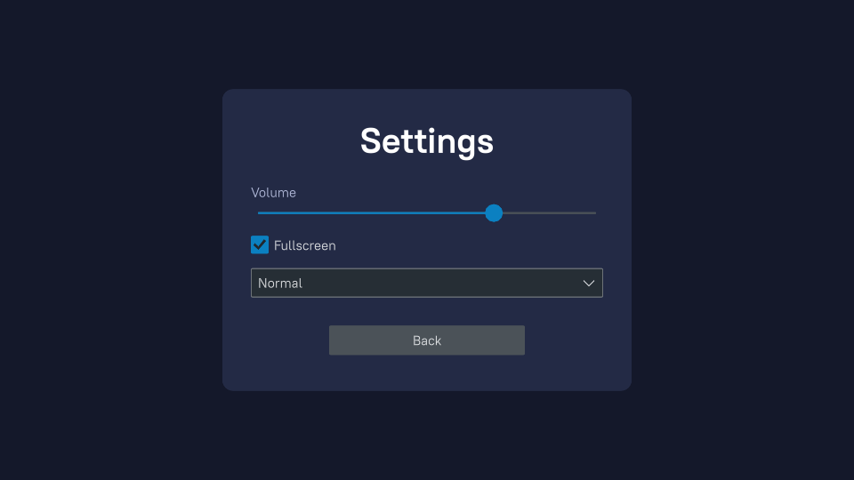
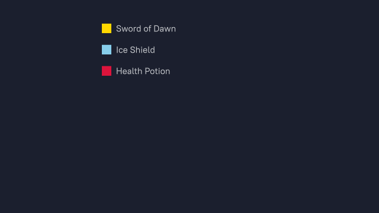
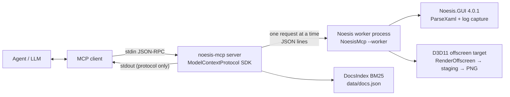

# MCP-of-Noesis

An MCP server that lets AI coding agents (Claude Code, Cursor, Copilot, ...) **write NoesisGUI XAML, check it with the real Noesis SDK, and see what it renders.**



*Rendered offscreen by `render_xaml` through Noesis's own D3D11 renderer, with no window and no game running.*

## Why

NoesisGUI uses WPF-style XAML but implements only part of WPF. LLMs have seen far more WPF/WinUI/MAUI XAML than Noesis XAML, so agents confidently write markup that fails to load in Noesis (`DataGrid`, `Polygon`, `RichTextBox`, ...), and they can't check their work. This server closes that loop:

```
write XAML → validate_xaml → fix "Line 2, Col 3: Unknown element type 'Buton'" → validate_xaml → OK → render_xaml → look at the PNG
```

## Tools

| Tool | Input | Output |
|------|-------|--------|
| `validate_xaml` | `xaml` | `OK (root: Grid)`, or one line per error, `Line L, Col C: message (hint: ...)`, from the Noesis parser itself |
| `render_xaml` | `xaml`, `width`=1280, `height`=720, `time`=1.0, `theme`=DarkBlue, `sample_data` (JSON), `save_to` | PNG image + `Rendered 1280x720 in 48 ms on <GPU>`; errors instead if the XAML is invalid |
| `search_docs` | `query`, `max_results`=5 | Top matches from a local index of the official Noesis docs: title, URL, ≤500-char snippet |
| `list_controls` | `type_name`?, `filter`? | XAML types in the installed SDK, or one type's properties/attached properties/events (read from the SDK by reflection) |
| `wpf_differences` | none | Which of ~100 common WPF types are *not* in Noesis, probed live against the parser, plus porting notes |

Some details:

- **`sample_data`** turns JSON into real CLR objects (classes emitted at runtime), so `{Binding Score}` and `ItemsSource="{Binding Items}"` show real values in the preview.
- **`time`** captures a frame partway through `Loaded` storyboards. Use 0 for the first frame of an intro animation.
- Bad XAML is a normal tool result with `isError: true`, never a protocol error, so the agent can read it and fix it.

<p>
  
  
</p>

## Setup (Windows x64)

Requirements: .NET 10 SDK, a D3D11-capable GPU (falls back to WARP software rendering), and Python 3 (for the docs index only).

```bash
git clone https://github.com/Yashagarwal9798/MCP-of-Noesis && cd MCP-of-Noesis
dotnet publish src/NoesisMcp -c Release -o dist
python scripts/fetch-docs.py            # optional: builds data/docs.json for search_docs (~3 min)

claude mcp add noesis -- "$PWD/dist/NoesisMcp.exe"
```

Then in Claude Code: `/mcp` should list `noesis` with 5 tools. Try *"Build a settings menu in Noesis XAML, validate it and render it."*

If .NET is installed per user rather than in `C:\Program Files\dotnet`, pass `-e DOTNET_ROOT=<path to dotnet>` to `claude mcp add`.

Other MCP hosts use the same stdio command (`dist/NoesisMcp.exe`, no arguments).

### License key

Without a key, Noesis runs in evaluation mode, where views stop rendering after 10 minutes. The server handles this by recycling its Noesis worker process every 9 minutes, so you won't notice. With a license, set `NOESIS_LICENSE_NAME` and `NOESIS_LICENSE_KEY` and recycling turns off. `NOESIS_MCP_RECYCLE_SECONDS` overrides the interval.

## How it works



- **Worker process.** Noesis is native C++ and some XAML can crash it. A native crash can't be caught in .NET, so all Noesis work runs in a child process (the same exe with `--worker`). If it crashes or hangs past 30 s, the server returns a normal error ("the worker exited ... it has been restarted") and starts a new one.
- **One thread.** Noesis objects are single-threaded, so the worker handles one request at a time and the server queues the rest.
- **Validation** uses `GUI.ParseXaml` with Noesis's log callback. Noesis reports `<memory>(line,col): message`, which becomes `Line L, Col C: message`, plus a hint for the common cases (unknown type → `list_controls`/`wpf_differences`, missing xmlns, StaticResource order, ...).
- **Rendering** creates a headless D3D11 device (SharpDX), hands its context to `RenderDeviceD3D11`, and draws real frames up to `time` (Noesis fires `Loaded` only after a frame is drawn), then copies the target to a staging texture and encodes a PNG with the BCL's zlib.
- **stdout carries protocol messages only.** All logs, including Noesis's, go to stderr.

More detail: [docs/ARCHITECTURE.md](docs/ARCHITECTURE.md).

## Tests

```bash
dotnet test                                   # 40 tests: XAML corpus, rendering, docs ranking, formats
dotnet build src/NoesisMcp -c Release && python tests/smoke.py   # JSON-RPC over stdio, like a real host
```

`tests/xaml/` holds `valid/`, `invalid/` and `wpf-only/` files. Each one states its expected result in its first line (`<!-- expect: ... -->`).

## Limits and known issues

- Windows x64 only for now (Noesis native DLL + D3D11). Linux/macOS would need the GL render device.
- XAML ≤ 200 KB, render size ≤ 3840×2160.
- `x:Class` and custom controls need the game's own types, so previews should leave them out.
- `Window` roots are previewed as their content, because a Window needs a native display.
- Found while building this: when the theme is used outside `NoesisApp.Application` (`GUI.Init` + `Application.SetThemeProviders()` + `GUI.LoadApplicationResources(...)`), Noesis 4.0.1 logs `Font not found 'Fonts/#PT Root UI'` and falls back to Arial. Inside `Application` the fonts load fine. The server adds a fallback `EmbeddedFontProvider(themeAssembly, "")`, which fixes it.

## Licensing

The code in this repository is MIT licensed. NoesisGUI is proprietary software by Noesis Technologies. It is pulled from NuGet at build time and isn't redistributed here, and neither are the Noesis docs: `scripts/fetch-docs.py` builds a local index on your machine (`data/` is gitignored). Not affiliated with Noesis Technologies.
