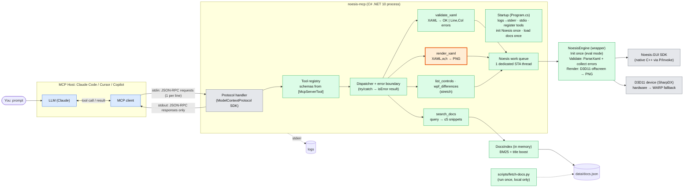
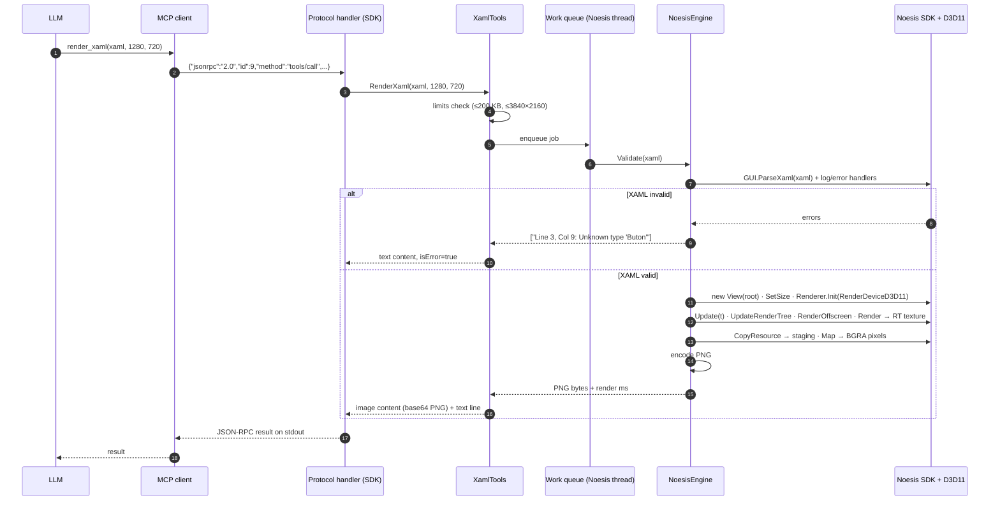
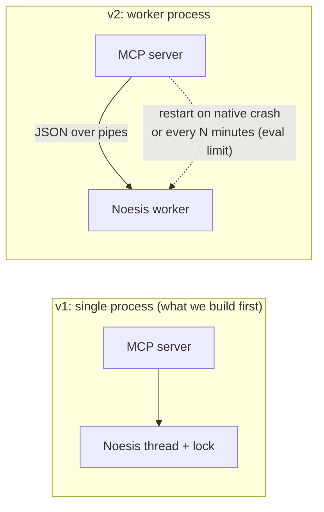
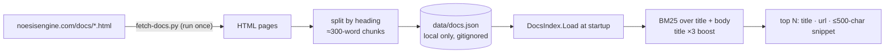
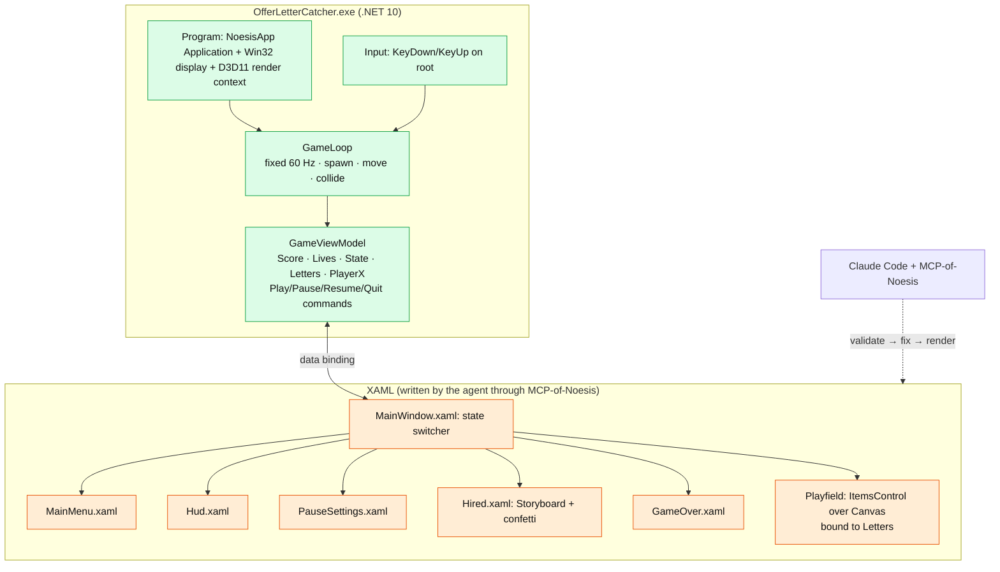

# Architecture

Two deliverables share one idea: **the agent only writes XAML, and Noesis itself decides whether it is right.**

Colour key in every diagram: blue = host, green = code we write, grey = things we didn't write (MCP SDK, Noesis SDK), orange = `render_xaml` (the demo highlight).

## 1. MCP-of-Noesis: component view



## 2. One `render_xaml` call, end to end



## 3. Process model: v1 (built) and v2 (robust)



- **Threads:** Noesis objects are single-threaded. Every Noesis call runs on one dedicated thread, which also owns the D3D11 immediate context.
- **Crashes:** native C++ crashes can't be caught in .NET. v1 accepts this. v2 moves Noesis into a child process so the server can answer "XAML crashed the renderer" and restart it.
- **Eval limit:** in evaluation mode Noesis runs 10 minutes per session. If rendering stops after that, the v2 worker is recycled.

## 4. Render pipeline detail

```mermaid
flowchart LR
    X[XAML string] --> P[GUI.ParseXaml] --> R[FrameworkElement root]
    R --> V[new View root] --> S[SetSize w×h · SetFlags PPAA]
    S --> I[Renderer.Init RenderDeviceD3D11 ctx]
    I --> U[View.Update t · Renderer.UpdateRenderTree]
    U --> O[Renderer.RenderOffscreen]
    O --> RT[Bind RT texture + depth/stencil · Clear · Viewport]
    RT --> RR[Renderer.Render]
    RR --> CP[CopyResource → staging texture]
    CP --> M[Map → BGRA rows] --> PNG[PNG encoder] --> B64[base64 image content]
```



- Render target: `B8G8R8A8_UNorm`, 1 sample. Stencil buffer `D24_UNorm_S8_UInt`, which Noesis needs for clipping.
- Theme: Noesis.App.Theme resources (NoesisTheme.DarkBlue) merged so standard controls (Button, Slider, CheckBox) have visuals, like the app does.
- PNG: a small built-in encoder (zlib from `System.IO.Compression`), so no image library is needed.

## 5. Docs index



## 6. Offer Letter Catcher (Phase 2)



Game states: `Menu → Playing ⇄ Paused → Hired | GameOver → Menu/Playing`. The XAML switches screens with `DataTrigger`s on `State`. No code-behind decides what is visible.

## 7. Repository layout

```
MCP-of-Noesis/                     (separate GitHub repo)
  src/NoesisMcp/
    Program.cs                     startup, stdio, DI
    Tools/XamlTools.cs             validate_xaml, render_xaml, list_controls
    Tools/DocsTools.cs             search_docs, wpf_differences
    Engine/NoesisEngine.cs         the only code that touches Noesis
    Engine/NoesisThread.cs         one-at-a-time work queue
    Engine/D3DOffscreen.cs         headless D3D11 target + readback
    Engine/Png.cs                  minimal PNG encoder
    Engine/ErrorFormat.cs          "Line, Col: message" + hints
    Docs/DocsIndex.cs              BM25 search
  scripts/fetch-docs.py            builds data/docs.json locally
  tests/NoesisMcp.Tests/           xUnit over tests/xaml corpus
  tests/xaml/{valid,invalid,wpf-only}/
  tests/smoke.py                   stdio protocol smoke test
  docs/                            renders, GIF
  README.md

offer-letter-catcher/              (game, built with the MCP)
  src/OfferLetterCatcher/
    Program.cs  App.xaml  MainWindow.xaml(.cs)
    Game/GameLoop.cs  Game/GameViewModel.cs  Game/Letter.cs
    Views/*.xaml                   agent-written screens
  docs/agent-log.md  docs/renders/*.png
```
